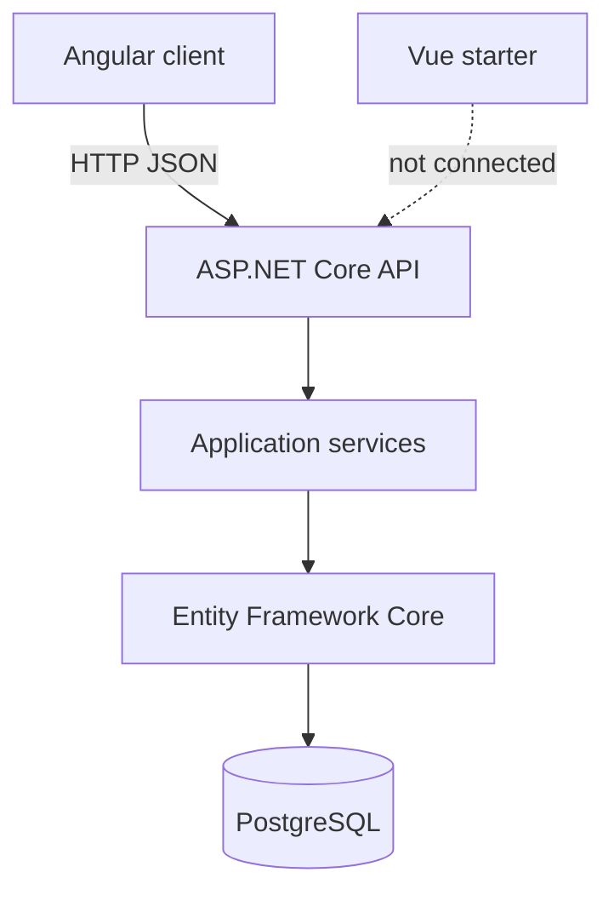

# Business Marketplace — Full-Stack Engineering Practice

An independent educational project for browsing fictional businesses for sale. It is inspired by business-for-sale marketplaces.

The Angular application is the working client. It searches, filters, sorts, and pages listings served by an ASP.NET Core API. The API persists those listings in PostgreSQL with Entity Framework Core. A Vue application is in the same Nx workspace as a starter and does not call the API yet.

Nx keeps the clients and the API in one repository so they can be built and tested with a shared command style. Both frontends are meant to consume the same HTTP API. There is no shared TypeScript contract package yet.

## Contents

- [Technology stack](#technology-stack)
- [Monorepo structure](#monorepo-structure)
- [Architecture overview](#architecture-overview)
- [Prerequisites](#prerequisites)
- [Getting started](#getting-started)
- [Local development URLs](#local-development-urls)
- [API documentation](#api-documentation)
- [Database and migrations](#database-and-migrations)
- [Development seed data](#development-seed-data)
- [Testing](#testing)
- [Engineering practices](#engineering-practices)
- [Project status and roadmap](#project-status-and-roadmap)
- [Troubleshooting](#troubleshooting)
- [License](#license)

## Technology stack

Versions below are the ranges and packages declared in this repository.

| Area | Choice |
| --- | --- |
| Frontend frameworks | Angular ~22.1, Vue ^3.5 |
| Languages | TypeScript ~6.0 (Angular and Vue), C# (.NET 10) |
| Backend | ASP.NET Core Web API, target framework `net10.0` |
| Database | PostgreSQL 17 (`postgres:17` in Docker Compose) |
| ORM | Entity Framework Core 10.0.13 with Npgsql.EntityFrameworkCore.PostgreSQL 10.0.3 |
| Monorepo | Nx 23.3 |
| Package manager | pnpm 12.14.0 (`packageManager` in `package.json`) |
| Development infrastructure | Docker Compose, Kestrel on HTTP |
| API tests | xUnit 2.9.3, Microsoft.AspNetCore.Mvc.Testing 10.0.13, Testcontainers.PostgreSql 4.16.0, Coverlet collector 6.0.4 |
| Frontend tests | Angular unit tests through `@angular/build:unit-test`; Vue tests through Vitest ^4 and Vue Test Utils |

Angular also uses RxJS ~7.8 and SCSS. Vue uses Vue Router ^4.5 and Vite ^8. The API document is produced by Microsoft.AspNetCore.OpenApi 10.0.13 and viewed with Swashbuckle.AspNetCore.SwaggerUI 10.3.0.

## Monorepo structure

```text
business-marketplace/
  apps/
    angular-web/                 Angular client
      src/app/
        core/                    API base URL token
        features/listings/       Search, filters, cards, pagination
        layout/                  Header and footer
        pages/                   Unknown-route page
      public/listings/           Local SVG placeholders
    vue-web/                     Vue 3 starter (Vite + Vue Router)
      src/views/                 Home and About
    api/
      BusinessMarketplace.slnx   .NET solution
      BusinessMarketplace.Api/
        Configuration/           CORS settings bound from configuration
        Controllers/             HTTP endpoints
        Data/                    EF Core context, Fluent configuration, migrations, seed
        Diagnostics/             Exception handler, ProblemDetails, readiness check
        Dtos/                    JSON request and response shapes
        Mapping/                 Copies from BusinessListing to DTOs
        Models/                  Listing entity and enums
        Services/                Application services
      BusinessMarketplace.Api.Tests/
        Integration/             PostgreSQL tests (Testcontainers)
  docker-compose.yml             Local PostgreSQL 17
  dotnet-tools.json              Local dotnet-ef 10.0.13 tool
  nx.json
  package.json
  pnpm-workspace.yaml
  tsconfig.base.json
  eslint.config.mjs
```

Application work is the Nx projects `angular-web`, `vue-web`, and `api`. The root `package.json` is the workspace manifest. `libs/shared/types` does not exist.

`apps/api/BusinessMarketplace.Api/Data/Migrations/` contains the EF Core migration `20261018124056_InitialCreate`.

## Architecture overview



The browsers talk to the API over HTTP. Angular's `API_BASE_URL` is `http://localhost:5000`. Controllers bind the request, call a service, map domain objects to DTOs, and choose the status code. They do not query PostgreSQL themselves.

`Program.cs` is the composition root. `IBusinessListingService` is registered scoped so it can take the scoped `AppDbContext`. `HealthService` is a singleton and does not open a database connection. DTOs are the JSON contract. `BusinessListing` is the entity. Mapping is written by hand.

Entity Framework translates the listing query to SQL. Reads use `AsNoTracking`. The only secondary index is `IX_BusinessListings_Status`, because the public list filters on Active listings. Category and status are stored as enum names (`Restaurant`, `Active`), which matches the JSON values.

Vue is a separate client in the workspace. It does not send listing requests.

## Prerequisites

- Node.js 22 or newer. The workspace types use `@types/node` ^22. `package.json` does not set an `engines` field.
- pnpm 12.14.0
- .NET 10 SDK (`net10.0`)
- Docker with Docker Compose (`docker compose`)

PostgreSQL is started from `docker-compose.yml`. A PostgreSQL install on the host is not required.

## Getting started

Run these commands from the repository root, in this order.

1. Install JavaScript dependencies.

   ```bash
   pnpm install
   ```

2. Start PostgreSQL.

   ```bash
   docker compose up -d
   ```

   The host port defaults to 5432. If that port is taken, set `POSTGRES_PORT` and point the API at the same port with `ConnectionStrings__DefaultConnection`. The database name, user, and local password live in `docker-compose.yml` and `apps/api/BusinessMarketplace.Api/appsettings.Development.json`. They are development defaults.

3. Install the local EF Core tool and apply migrations. Startup does not migrate.

   ```bash
   dotnet tool restore
   dotnet tool run dotnet-ef database update --project apps/api/BusinessMarketplace.Api
   ```

4. Seed development listings. Stop `nx serve api` first if it is running. Seeding builds the same executable, and a running API locks that file on Windows.

   ```bash
   pnpm exec nx seed api
   ```

5. Start the API, then the Angular client. Start Vue only when you want the starter shell.

   ```bash
   pnpm exec nx serve api
   pnpm exec nx serve angular-web
   pnpm exec nx serve vue-web
   ```

Build each project with:

```bash
pnpm exec nx build angular-web
pnpm exec nx build vue-web
pnpm exec nx build api
```

`nx build api` runs `dotnet build apps/api/BusinessMarketplace.slnx`. Nx has no .NET plugin here. The `api` targets call `dotnet` through `nx:run-commands`. Vue serve, build, and test targets are inferred from the Vite and Vitest plugins in `nx.json`.

## Local development URLs

| Application | Nx project | URL |
| --- | --- | --- |
| Angular | `angular-web` | http://localhost:4200 |
| Angular listings | `angular-web` | http://localhost:4200/listings |
| Vue | `vue-web` | http://localhost:4201 |
| API | `api` | http://localhost:5000 |

`/` on the Angular app redirects to `/listings`. Vue is pinned to 4201 with `strictPort`, so it does not move onto Angular's port. The API launch profile listens on HTTP only. Vue's Vite preview server is port 4300 (`nx preview vue-web`).

In Development only:

| Resource | URL |
| --- | --- |
| OpenAPI document | http://localhost:5000/openapi/v1.json |
| Swagger UI | http://localhost:5000/swagger |
| Process health | http://localhost:5000/api/health |
| Liveness | http://localhost:5000/api/health/live |
| Readiness | http://localhost:5000/api/health/ready |

## API documentation

JSON property names are camelCase. Enum values are PascalCase strings. Money is a JSON number in US dollars. Null means the seller did not disclose that figure, or the listing has no image URL.

Public listing routes return Active rows only. Draft, Pending, and Sold listings are stored and are not returned by these routes. An unknown id and a non-active id both produce the same 404 body.

### `GET /api/listings`

One page of active listing cards.

| Query | Rule |
| --- | --- |
| `search` | Optional. Case-insensitive substring of title, description, city, or state. Maximum 200 characters. Blank is ignored. |
| `category` | Optional. `Restaurant`, `Retail`, `Technology`, `Healthcare`, `Manufacturing`, `ProfessionalServices`, or `Other`. |
| `minPrice`, `maxPrice` | Optional inclusive bounds from 0 to 1000000000. `minPrice` greater than `maxPrice` is 400. |
| `sortBy` | `AskingPrice`, `AnnualRevenue`, or `CreatedAt`. Default `CreatedAt`. |
| `sortDirection` | `Asc` or `Desc`. Default `Desc` (newest first). |
| `page` | Default 1. Allowed range 1 to 10000. A page past the end is 200 with an empty `items` array and the real `totalCount`. |
| `pageSize` | Default 6. Allowed range 1 to 24. |

An unknown enum, a non-numeric price, or a value outside those ranges is HTTP 400 before the action runs. No matches is HTTP 200, not 404.

`items` contains summary objects. The summary does not include `status`, `createdAt`, or `updatedAt`. `totalCount` is the number of Active rows that match, before skip and take. The response has no `totalPages` field.

Example:

```http
GET /api/listings?search=Cedar%20Bakery&category=Restaurant&page=1&pageSize=6
```

```json
{
  "items": [
    {
      "id": "01910000-0000-7000-8000-000000000008",
      "title": "Cedar Bakery",
      "description": "Cedar Bakery is a fictional restaurant business in Tampa, FL. It has operated for 10 years with about 9 people on the payroll. A transferable lease has several years remaining.",
      "askingPrice": 114085.00,
      "annualRevenue": 193944.50,
      "cashFlow": 27152.23,
      "city": "Tampa",
      "state": "FL",
      "category": "Restaurant",
      "imageUrl": null
    }
  ],
  "page": 1,
  "pageSize": 6,
  "totalCount": 1
}
```

That row comes from the deterministic development seed. Equal asking prices are ordered by id after the requested sort field.

### `GET /api/listings/{id}`

One Active listing. The detail DTO adds `status`, `createdAt`, and `updatedAt` to the summary fields. `createdAt` and `updatedAt` are ISO-8601 timestamps with an offset.

| Result | When |
| --- | --- |
| 200 | The id is an Active listing. |
| 404 | The id is missing, or the listing is Draft, Pending, or Sold. |
| 400 | `{id}` is not a GUID. The route has no `:guid` constraint, so model binding reports the failure. |

A 404 body looks like this:

```json
{
  "type": "https://tools.ietf.org/html/rfc9110#section-15.5.5",
  "title": "Not Found",
  "status": 404,
  "detail": "The requested resource was not found.",
  "instance": "/api/listings/01910000-0000-7000-8000-00000000000a",
  "traceId": "00-example-trace-id-00"
}
```

The body does not include the listing title or status. `traceId` is `Activity.Current.Id` when a trace is present, otherwise `HttpContext.TraceIdentifier`.

### Health

| Method and route | Response |
| --- | --- |
| `GET /api/health` | 200 JSON `{ "status": "ok", "message": "API is running" }`. Does not open PostgreSQL. |
| `GET /api/health/live` | Plain text `Healthy` when the process answers. |
| `GET /api/health/ready` | Plain text `Healthy`, or `Unhealthy` with HTTP 503, after `CanConnectAsync`. The body is only that word. |

### Errors

Validation failures are HTTP 400 problem details with an `errors` object and a `traceId`. Unexpected exceptions are HTTP 500 problem details. The client title is "An unexpected error occurred." The client detail tells the caller to use the trace identifier. The exception message and stack trace are written to the server log and are not placed on the response.

Development CORS allows `http://localhost:4200` and `http://localhost:4201`, from `FrontendCors:Origins`. The middleware is not added outside Development. A missing origin list in Development stops startup.

There are no create, update, or delete listing routes.

## Database and migrations

`AppDbContext` exposes `DbSet<BusinessListing> BusinessListings`. The Fluent configuration in `Data/Configurations/BusinessListingConfiguration.cs` sets the table shape. The domain class has no EF attributes.

The table is `"BusinessListings"`. `Id` is a client-supplied `uuid`. Money columns are `numeric(18,2)`. `AnnualRevenue`, `CashFlow`, and `ImageUrl` are nullable. `Category` is `varchar(32)` and `Status` is `varchar(16)`, both storing the enum name. `CreatedAt` and `UpdatedAt` are `timestamptz` supplied by the application. The secondary index is `IX_BusinessListings_Status`.

The development connection string is `ConnectionStrings:DefaultConnection`. The environment variable `ConnectionStrings__DefaultConnection` overrides the JSON files. Startup throws if the value is missing. The API does not log the connection string. In Development, EF command logs are Information so SQL is visible. Connection logs stay at Warning.

Apply the existing migration:

```bash
dotnet tool restore
dotnet tool run dotnet-ef database update --project apps/api/BusinessMarketplace.Api
```

Add another migration into the same folder:

```bash
dotnet tool run dotnet-ef migrations add <Name> --project apps/api/BusinessMarketplace.Api --output-dir Data/Migrations
```

A migration changes the schema. The seed command inserts development rows. Startup does neither. `docker compose down` keeps the named volume. `docker compose down -v` deletes that data.

## Development seed data

Seeding runs only when you pass `--seed`, and only when `ASPNETCORE_ENVIRONMENT` is Development. The launch profile sets that environment. Production, Staging, and Testing are rejected before a connection is used. The API does not seed on startup or on a request.

```bash
pnpm exec nx seed api
```

The same command without Nx:

```bash
dotnet run --project apps/api/BusinessMarketplace.Api --launch-profile http -- --seed
```

One run inserts two catalogs when their ids are missing:

| Catalog | Rows | Identity |
| --- | --- | --- |
| `SampleBusinessListings` | 11 fixed examples | `01900000-0000-7000-8000-…0001` through `…000b` |
| `BusinessListingSeedGenerator` | 500 generated listings | `01910000-0000-7000-8000-000000000001` through `…01f4` |

The generated 500 are exactly 425 Active, 35 Pending, 25 Sold, and 15 Draft. Statuses are assigned in those counts and then shuffled with `System.Random` seeded by `3102026`, so they are not stored in four blocks. Categories use every existing `BusinessCategory` value. Cities are real city and state pairs across California, Texas, Florida, New York, Washington, Arizona, Colorado, Nevada, Oregon, Georgia, North Carolina, Illinois, Massachusetts, Tennessee, and Pennsylvania, including smaller markets. State is stored as the two-letter code.

Asking prices are `decimal` dollars from 50000 to 10000000. Some prices are repeated so sort order can be checked. Annual revenue and cash flow may be null. When both are present, cash flow is a margin of revenue. Generated `ImageUrl` values are null. Angular substitutes a local SVG for a null URL and for the sample catalog's `images.example` host. Dates are offsets from 1 October 2026 UTC, within the previous 730 days, and `UpdatedAt` is never earlier than `CreatedAt`. The generator does not call `DateTimeOffset.UtcNow` or `Guid.NewGuid()`.

A second `--seed` inserts nothing and does not overwrite a row you edited. To delete and recreate only the 500 generated ids, leaving the 11 examples and any other row in place:

```bash
dotnet run --project apps/api/BusinessMarketplace.Api --launch-profile http -- --seed --reset-generated
```

`--reset-generated` without `--seed` is rejected. Nothing truncates the whole table.

Count generated rows from the host. Bash:

```bash
docker exec -i business-marketplace-postgres psql -U postgres -d business_marketplace <<'SQL'
SELECT "Status", COUNT(*)
FROM "BusinessListings"
WHERE "Id"::text LIKE '01910000%'
GROUP BY 1
ORDER BY 1;
SQL
```

PowerShell:

```powershell
@'
SELECT "Status", COUNT(*)
FROM "BusinessListings"
WHERE "Id"::text LIKE '01910000%'
GROUP BY 1
ORDER BY 1;
'@ | docker exec -i business-marketplace-postgres psql -U postgres -d business_marketplace
```

`GET /api/listings` still returns only Active rows. With both catalogs present and no extra rows, that is 433 listings: 425 generated plus 8 Active examples.

To change the generated count, edit `Count` and the four status quotas in `BusinessListingSeedGenerator` so they still add up, then run the reset command. Changing `ReferenceDate` or `RandomSeed` does not rewrite rows that are already stored.

## Testing

There is no end-to-end project. `nx.json` sets the Angular application generator's `e2eTestRunner` to `none`.

| Command | What it runs |
| --- | --- |
| `pnpm exec nx test angular-web` | Angular unit tests (`@angular/build:unit-test`, watch disabled) |
| `pnpm exec nx test vue-web` | Vue Vitest specs in `apps/vue-web` |
| `pnpm exec nx test api` | Every xUnit test in `apps/api/BusinessMarketplace.slnx` |
| `pnpm exec nx test-unit api` | API tests whose category is not `Integration` |
| `pnpm exec nx test-integration api` | API tests marked `Category=Integration` |
| `pnpm exec nx test-coverage api` | All API tests with Coverlet XPlat coverage |

The equivalent .NET commands are `dotnet test apps/api/BusinessMarketplace.slnx` and the same command with `--filter Category!=Integration` or `--filter Category=Integration`.

Coverage for the API is written under `apps/api/coverage`. Vue's Vitest config can write coverage under `coverage/apps/vue-web`. This README does not record a coverage percentage.

API unit tests cover mapping, service rules that do not depend on SQL translation, controller results, the seed generator, and the development-only seed guard. Integration tests use `WebApplicationFactory` and one PostgreSQL 17 container started by Testcontainers. The database name is `business_marketplace_test`. Those tests apply EF migrations themselves, truncate between cases, and do not open the Compose database. Docker must be running for `test-integration`. `test-unit` does not need it.

`dotnet test` cannot copy `BusinessMarketplace.Api.exe` while `nx serve api` is running. Stop the API before a test run that rebuilds it.

## Engineering practices

- Angular and Vue compile with TypeScript `strict`. The Angular compiler also uses strict templates. The API enables nullable reference types.
- Listing reads go through `IBusinessListingService`. The controller depends on that interface. Persistence is `AppDbContext`, not a generic repository.
- Response DTOs are separate from `BusinessListing`.
- Expected 400 and 404 results are problem details. Unexpected failures are HTTP 500 problem details with a `traceId`. The server log receives the exception once.
- Log messages use structured templates. Successful listing reads are not logged. Connection strings are not logged.
- Listing actions take `CancellationToken` from the aborted HTTP request and pass it into EF Core.
- The Angular shell has a skip link, labeled controls, `aria-invalid` on filter errors, a live pagination region, and `prefers-reduced-motion`. Layout is mobile-first, with breakpoints at 48rem, 64rem, and 90rem.
- Search, category, price, sort, and paging run in PostgreSQL. The list query filters on `Status`, which is indexed.
- Angular turns HTTP status codes into short sentences and does not render the response body.

## Project status and roadmap

**Implemented**

- Angular listings page at `/listings`, with search, category, price bounds, sort, pagination, empty and error states, and local image placeholders
- Read-only listings API and process, liveness, and readiness checks
- PostgreSQL persistence, one migration, and the development seed described above
- API unit tests and PostgreSQL integration tests
- Vue home and about routes from the Nx starter

**Not started**

- Vue marketplace screens and API calls
- An Angular or Vue listing detail route (`GET /api/listings/{id}` is available to a future client)
- Authentication, listing writes, and a shared TypeScript contract library
- End-to-end tests

## Troubleshooting

**The API exits immediately and says the connection string is not set.** Set `ConnectionStrings:DefaultConnection` for Development, or export `ConnectionStrings__DefaultConnection`. The process also exits in Development when `FrontendCors:Origins` is empty.

**PostgreSQL connection failures.** Run `docker compose ps` and confirm `business-marketplace-postgres` is up. If port 5432 is already published by another container, start Compose with another `POSTGRES_PORT` and set `ConnectionStrings__DefaultConnection` to that same port. The seed and the API must use the same database.

**Docker is not running.** `docker compose up` fails, and `nx test-integration api` cannot start its PostgreSQL container. `nx test-unit api` still runs.

**Migrations.** `database update` is a separate command. Restarting the API does not create tables. If the database volume was removed, apply the migration again and then seed.

**Port already in use.** Angular expects 4200, Vue expects 4201 and will not switch ports, and the API serve target binds http://localhost:5000. Stop the other process or change that target deliberately.

**The browser shows a network error from the Angular app.** The API must be running on port 5000. CORS headers are added only in Development, and only for the origins in `FrontendCors:Origins`. A production environment does not add that middleware.

**Seeding fails because the executable is locked, or it refuses the environment.** Stop `nx serve api` before `nx seed api`. `--seed` runs only in Development. `--reset-generated` has to be passed together with `--seed`.

**`nx seed api` inserted 0 rows.** Those ids are already stored. A second run is supposed to insert nothing. Use `--seed --reset-generated` when you intend to replace the generated 500.

## License

This repository does not contain a `LICENSE` file. `package.json` records `"license": "ISC"` on the workspace manifest. That field is not a license grant by itself.
